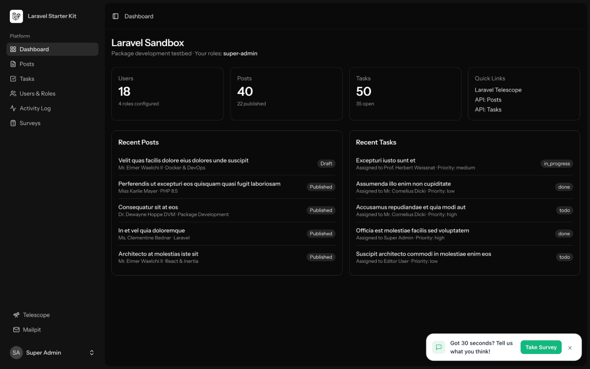
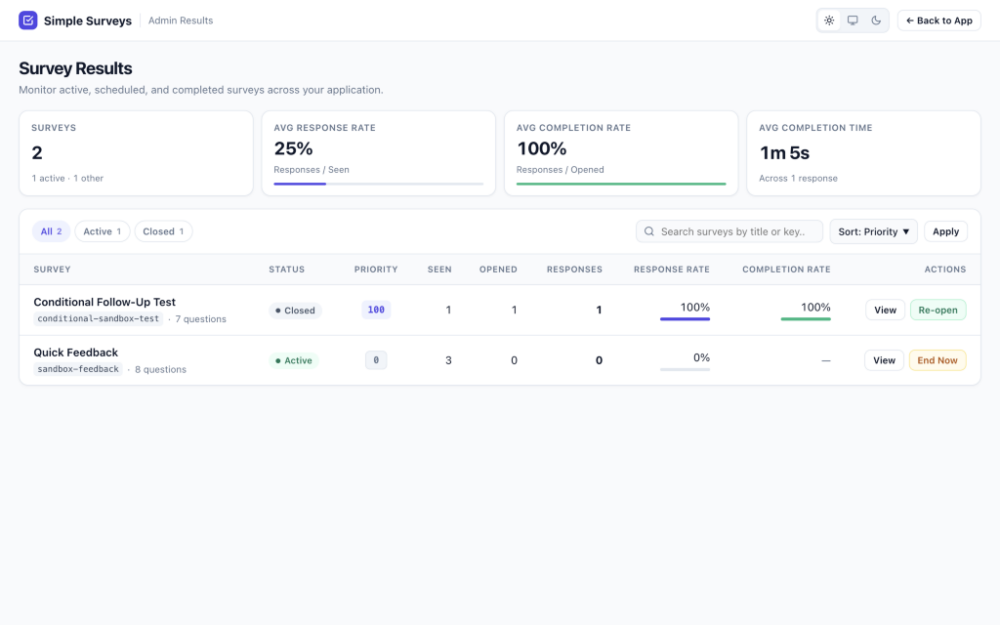
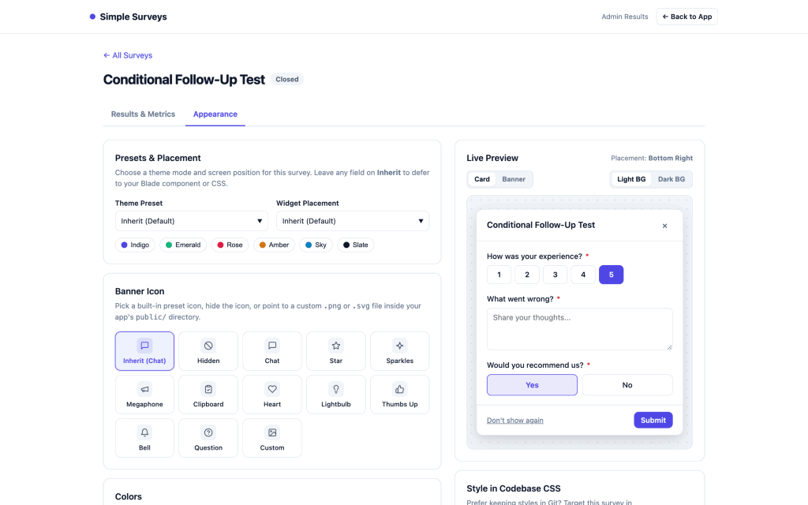
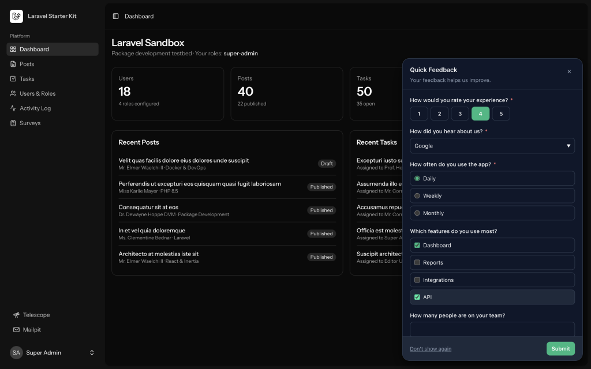
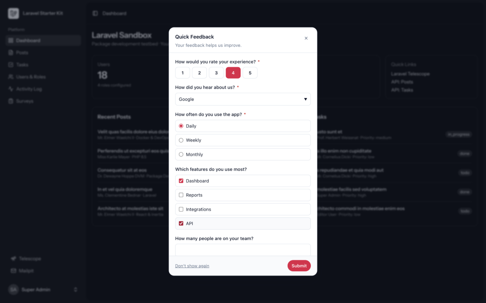

# Laravel Simple Surveys

[](https://github.com/danielCristeaa/laravel-simple-surveys/actions/workflows/ci.yml)
[](https://packagist.org/packages/danielcristea/laravel-simple-surveys)
[](https://packagist.org/packages/danielcristea/laravel-simple-surveys)
[](https://packagist.org/packages/danielcristea/laravel-simple-surveys)
[](LICENSE.md)

A lightweight, code-first Laravel package for running targeted in-app surveys with a drop-in Blade widget, headless JSON API, and a protected Admin Results Dashboard.



---

## Features

- **Code-first fluent API:** Define surveys, 8 input types, and conditional follow-ups (`->when(...)`) directly in PHP or `SurveyDefinition` classes.
- **Drop-in Blade widget:** Mount `<x-simple-surveys::widget />` once—zero JS build step, zero CSS leaks, light/dark/auto themes, 5 placements (including centered modal), and Inertia/Livewire `dynamic` SPA mode.
- **Headless JSON API:** Built-in endpoints for React, Vue, Next.js, Nuxt, or mobile apps over Sanctum/Passport.
- **Flexible styling:** Customize globally or per survey via zero-specificity `--lss-*` CSS custom properties, or visually with a live preview in the Admin **Appearance** tab.
- **Eloquent & page targeting:** Target authenticated users with real Eloquent queries (`where`, `whereHas`), user predicates, route/path rules, schedules, and dismissal re-prompt cooldowns.
- **Multi-language ready:** Publishable widget UI strings, convention-based `lang/{locale}/simple-surveys.php` scaffolding (`simple-surveys:translations`), and automatic respondent `locale` recording.
- **Analytics, webhooks & notifications:** Built-in funnel tracking (seen, opened, abandoned, response/completion rates), browser `CustomEvent`s, tracking context snapshots, signed webhooks, and Mail/Slack submission alerts.
- **Octane-safe, CSP-ready & strictly typed:** PHP 8.2+, Laravel 11.x / 12.x / 13.x, strict Content-Security-Policy nonce support (zero inline `style`/event attributes), PHPStan Level 8+.



---

## Requirements

- PHP `8.2+`
- Laravel `11.x`, `12.x`, or `13.x`

## Installation

Install the package via Composer:

```bash
composer require danielcristea/laravel-simple-surveys
```

Publish and run the migration:

```bash
php artisan vendor:publish --tag="simple-surveys-migrations"
php artisan migrate
```

Optionally publish the configuration file:

```bash
php artisan vendor:publish --tag="simple-surveys-config"
```

---

## Quick Start

### 1. Register a Survey

Register a survey in `AppServiceProvider::boot()` (or a dedicated service provider):

```php
use DanielCristea\SimpleSurveys\Facades\SimpleSurveys;
use DanielCristea\SimpleSurveys\Question;
use DanielCristea\SimpleSurveys\Survey;
use Illuminate\Database\Eloquent\Builder;

SimpleSurveys::register(
    Survey::make('onboarding-feedback')
        ->title('Quick Onboarding Survey')
        ->banner('Got 30 seconds? Help us improve onboarding!')
        ->target(fn (Builder $query) => $query->where('created_at', '<=', now()->subDays(7)))
        ->questions([
            Question::rating('experience', 'How would you rate your experience?')
                ->scale(1, 5)
                ->required(),
            Question::textarea('low_score_reason', 'What could we have done better?')
                ->when('experience', '<=', 3)
                ->required(),
            Question::boolean('recommend', 'Would you recommend us to a colleague?')
                ->required(),
        ])
);
```

### 2. Mount the Customer Widget

Drop the Blade component into your layout before `</body>`:

```blade
<x-simple-surveys::widget />
```

For Inertia.js or Livewire (`wire:navigate`), pass `dynamic`:

```blade
<x-simple-surveys::widget dynamic />
```

The widget renders nothing for guests (0 DB queries) or users without eligible surveys.

### 3. Open the Admin Results Dashboard

Authorize admin access via the `viewSimpleSurveys` Gate in `AppServiceProvider::boot()`:

```php
use Illuminate\Support\Facades\Gate;

Gate::define('viewSimpleSurveys', fn ($user): bool => (bool) $user->is_admin);
```

Then visit `/simple-surveys/admin` to inspect funnel metrics, inline SVG charts (conversion funnel, time-series trends, rating histograms/NPS, boolean donuts), searchable & cross-filterable responses with a slide-over detail drawer, Light/Dark mode, CSV exports, lifecycle controls, and the live **Appearance** editor.



| Dark Theme (`bottom-right`, Emerald) | Centered Modal (`center`, Rose) |
| :---: | :---: |
|  |  |

> Explore all themes, placements, and CSS token overrides in the [Appearance & Styling gallery](docs/styling.md#widget-preset-gallery).

---

## Documentation

| Guide | What You'll Learn |
| :--- | :--- |
| [**Defining Surveys**](docs/defining-surveys.md) | `Survey` & `Question` fluent API tables, all 8 question types, `SurveyDefinition` classes, conditional logic (`->when`), and DB syncing |
| [**Audience Targeting & Scheduling**](docs/targeting.md) | Eloquent `->target()`, `->targetUser()`, route/path rules (`onRoutes`, `onPaths`), schedules, re-prompt cooldowns, and priority order |
| [**Customer Widget & SPA Mode**](docs/widget.md) | Component attributes (`position`, `theme`, `icon`, `survey`, `nonce`), Inertia/Livewire `dynamic` mode, CSP nonces, and publishing Blade views |
| [**Appearance & Styling**](docs/styling.md) | `--lss-*` CSS custom properties, global vs per-survey overrides, style precedence, and the Admin **Appearance** tab |
| [**Headless / API-Only Setup**](docs/headless-api.md) | Sanctum/Passport Bearer & cookie auth, CORS, JSON endpoints (`?survey=`, `?url=`), `duration_ms`, and a full React example |
| [**Admin Results Dashboard**](docs/admin-dashboard.md) | Gate authorization, funnel metrics, End/Re-open/Reset controls, CSV exports, programmatic PHP results API (`SimpleSurveys::results()`), and `simple-surveys:results` CLI |
| [**Localization & Translations**](docs/localization.md) | Publishable widget chrome, `lang/{locale}/simple-surveys.php` scaffolding (`simple-surveys:translations`), and locale recording |
| [**Analytics, Events & Tracking**](docs/analytics-and-tracking.md) | Browser `CustomEvent`s (GA4/PostHog/Mixpanel), tracking cookies, `resolveTrackingContext`, and Laravel lifecycle events |
| [**Webhooks & Notifications**](docs/webhooks-and-notifications.md) | Signed lifecycle webhooks (HMAC-SHA256, queues/retries) and Mail/Slack/custom submission notifications |
| [**Configuration & Artisan Commands**](docs/configuration.md) | Full `config/simple-surveys.php` reference, publish tags, CLI commands, CSP nonces, UUID/ULID respondents, and Octane notes |
| [**Recipes & Walkthroughs**](docs/recipes.md) | End-to-end walkthroughs for CSAT + Slack alerts, multi-language cohort tracking, Inertia/Livewire SPAs, and multi-theme styling |

---

## Testing & Quality

```bash
composer test
composer analyse
composer format:check
```

## Changelog, Contributing & Security

- See [CHANGELOG.md](CHANGELOG.md) for release notes and version history.
- See [CONTRIBUTING.md](CONTRIBUTING.md) for local development setup and pull request guidelines.
- See [SECURITY.md](SECURITY.md) for responsible security vulnerability reporting.

## License

The MIT License (MIT). Please see [LICENSE.md](LICENSE.md) for more information.
