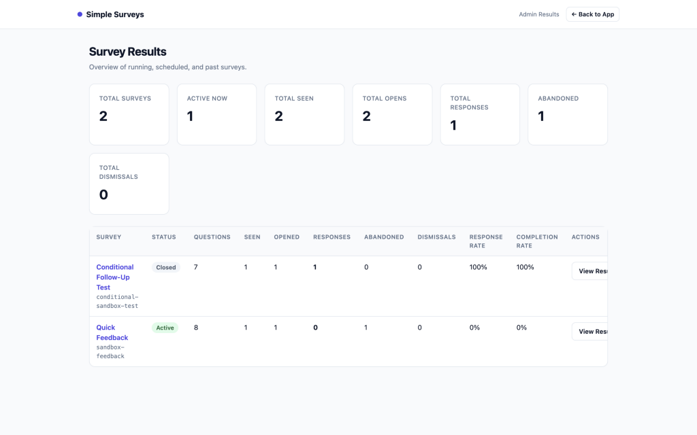
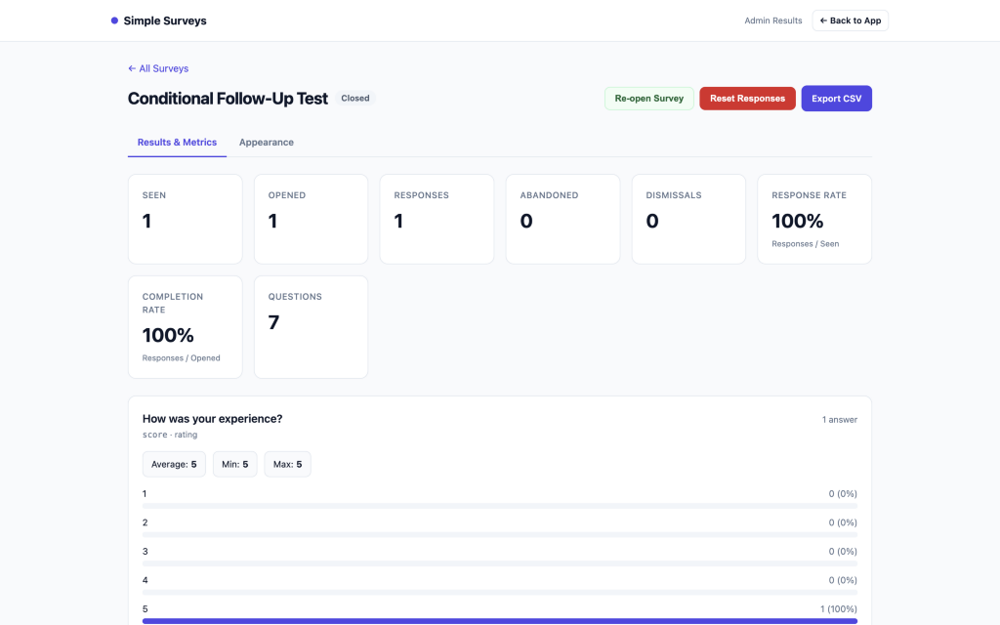
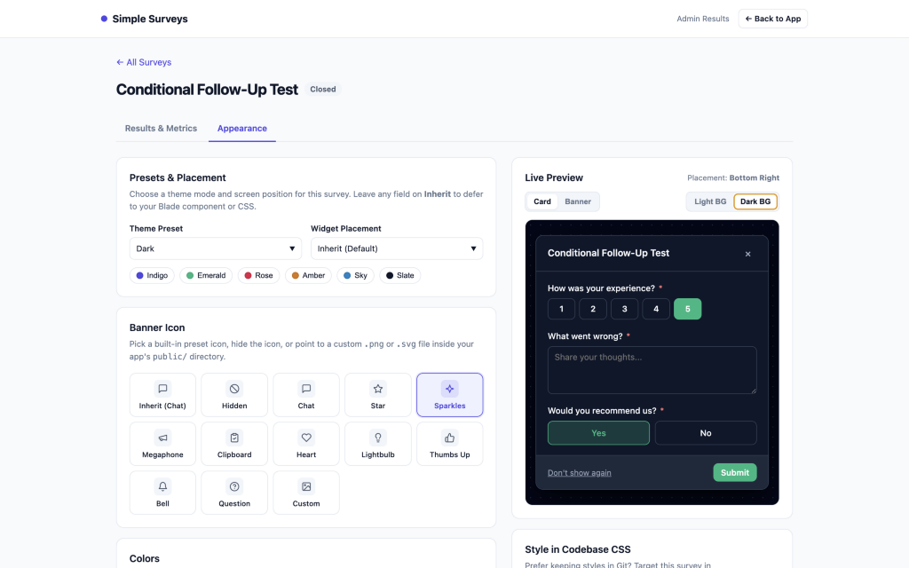

[← Back to README](../README.md)

# Admin Results Dashboard

Simple Surveys ships with a self-contained, Gate-protected Admin Dashboard at `/simple-surveys/admin` (configurable in `config/simple-surveys.php`)—no frontend build step required.



---

## Authorizing Access

Define the `viewSimpleSurveys` Gate in your `AppServiceProvider::boot()`:

```php
use Illuminate\Support\Facades\Gate;

Gate::define('viewSimpleSurveys', function ($user): bool {
    return $user->is_admin; // Or $user->can('view-surveys')
});
```

Any user who fails the Gate receives `403 Forbidden`. You can change the Gate name, URL prefix, and middleware stack in `config/simple-surveys.php` under `admin`.

---

## Overview & Funnel Metrics

The overview page lists every code-registered survey (active, scheduled, draft, closed) plus historical/archived database surveys whose PHP definitions have since been removed.

Each survey reports the full conversion funnel:

| Metric | Definition |
| :--- | :--- |
| **Seen** | Unique respondents who had an impression recorded (`simple_survey_impressions`). |
| **Opened** | Unique respondents who expanded the survey card (`simple_survey_opens`). |
| **Responses** | Completed submissions (`simple_survey_responses`). |
| **Abandoned** | Respondents who opened the survey card but have not submitted a response. |
| **Dismissals** | Unique respondents who dismissed the survey (`simple_survey_dismissals`). |
| **Response Rate** | `responses / seen` (capped at `100%`). |
| **Completion Rate** | `responses / opened` (capped at `100%`). |

---

## Per-Survey Analytics

Clicking any survey opens `/simple-surveys/admin/{surveyKey}` with:



- **Funnel summary cards** for that survey.
- **Per-question breakdowns** computed directly via SQL:
  - `rating` & `number`: average, min, max (plus score distribution bars for ratings).
  - `select`, `radio`, `checkbox`, `boolean`: option counts and percentage bars (historical removed option values are preserved cleanly).
  - `text` & `textarea`: total answer count and the 20 most recent responses.
- **Paginated individual responses** table showing respondent ID, submission timestamp, respondent `locale` (when recorded), duration, and answers.

---

## Lifecycle Controls & CSV Export

From a survey's detail header, authorized admins can manage live surveys without redeploying:

| Action | Route | Effect |
| :--- | :--- | :--- |
| **End Survey Now** | `POST /{adminPrefix}/{key}/close` | Syncs the survey if needed and sets DB status to `closed`, immediately stopping new widget renders and submissions. |
| **Re-open Survey** | `POST /{adminPrefix}/{key}/reopen` | Sets DB status back to `active` so eligible respondents can participate again. |
| **Reset Responses** | `POST /{adminPrefix}/{key}/reset` | Prompts with a confirmation modal, then clears responses, answers, dismissals, opens, and impressions for that survey (great for clearing QA data before launch). |
| **Export CSV** | `GET /{adminPrefix}/{key}/export` | Streams a UTF-8 CSV of every response and answer column—automatically appending `Locale`, `Duration (ms)`, and any resolved [tracking context](analytics-and-tracking.md) columns. |

---

## Appearance Tab

Click the **Appearance** tab on any registered survey to customize theme, placement, banner icon, colors, dimensions, and typography with a live preview.



See [Appearance & Styling](styling.md) for full details and how to disable the visual editor with `admin.appearance_editor => false`.

---

← Previous: [Headless / API-Only Setup](headless-api.md) | Next: [Localization & Translations →](localization.md)
