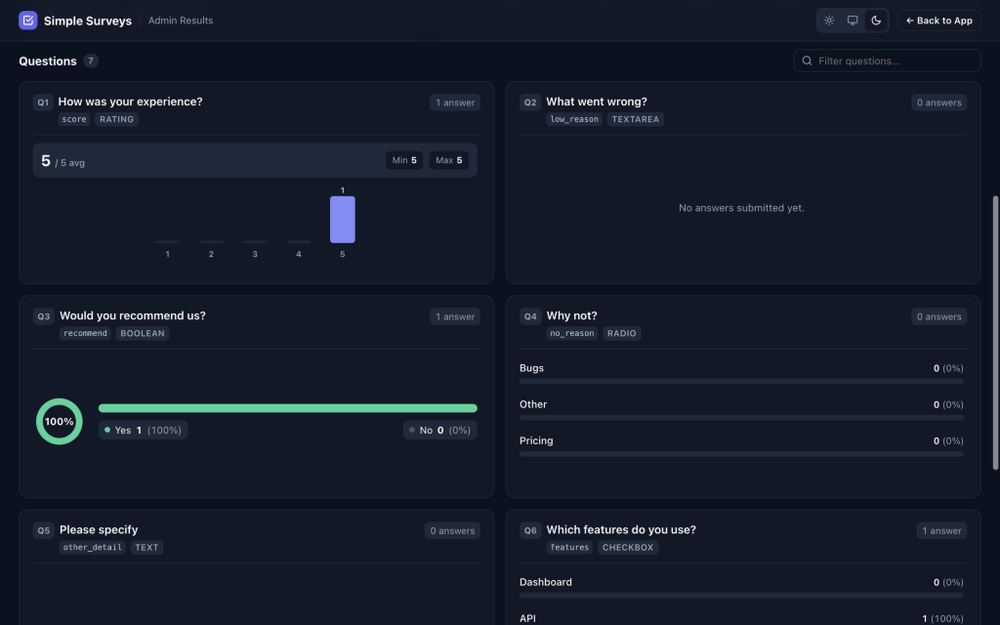

[← Back to README](../README.md)

# Admin Results Dashboard

Simple Surveys ships with a self-contained, Gate-protected Admin Dashboard at `/simple-surveys/admin` (configurable in `config/simple-surveys.php`)—with built-in **Light / System / Dark** mode, inline SVG charts, search & filtering, and zero frontend build step or external chart libraries required.


---

## Authorizing Access

Define the `viewSimpleSurveys` Gate in your `AppServiceProvider::boot()`:

```php
use Illuminate\Support\Facades\Gate;

Gate::define('viewSimpleSurveys', function ($user): bool {
    return $user->is_admin; // Or $user->can('view-surveys')
});
```

Any user who fails the Gate receives `403 Forbidden`. You can change the Gate name, URL prefix, and middleware stack in `config/simple-surveys.php` under `admin`.

---

## Overview, Filtering & Funnel Metrics

The overview page lists every code-registered survey (active, scheduled, draft, closed) plus historical/archived database surveys whose PHP definitions have since been removed.

At the top of the overview page:
- **4 summary KPI cards:** **Surveys** (active vs. other), **Avg Response Rate** (`Responses / Seen`), **Avg Completion Rate** (`Responses / Opened`), and **Avg Completion Time** (computed across responses with recorded `duration_ms`).
- **Search, status filter pills, and sorting:** Filter by status (`All`, `Active`, `Scheduled`, `Draft`, `Closed`, `Archived`), search by title, key, or description, and sort by `Priority`, `Most Responses`, `Most Seen`, `Response Rate`, `Completion Rate`, or `Title`.
- **Read-only Priority column:** Displays each survey's configured `->priority(...)` value (higher priority surveys display first when multiple surveys match a user).
- **Theme switcher:** Toggle **Light**, **System**, or **Dark** mode from the topbar (persisted in `localStorage`).

Each survey reports the full conversion funnel:

| Metric | Definition |
| :--- | :--- |
| **Seen** | Unique respondents who had an impression recorded (`simple_survey_impressions`). |
| **Opened** | Unique respondents who expanded the survey card (`simple_survey_opens`). |
| **Responses** | Completed submissions (`simple_survey_responses`). |
| **Abandoned** | Respondents who opened the survey card but have not submitted a response. |
| **Dismissals** | Unique respondents who dismissed the survey (`simple_survey_dismissals`). |
| **Response Rate** | `responses / seen` (capped at `100%`). |
| **Completion Rate** | `responses / opened` (capped at `100%`). |

---

## Per-Survey Analytics & Tabs

Clicking any survey opens `/simple-surveys/admin/{surveyKey}` with a breadcrumb **survey switcher**, compact metadata strip (`key`, read-only `Priority`, question count, schedule window), a date range switcher (**`All`**, **`7d`**, **`30d`**, **`90d`**), and three dedicated tabs:

### 1. Results & Metrics Tab




- **Compact 5-card KPI strip** (`Seen`, `Opened`, `Responses`, `Response Rate`, `Completion Rate`).
- **Conversion Funnel & Responses Over Time:** Visual `Seen → Opened → Submitted` funnel bars (with `Abandoned` & `Dismissals` drop-off chips) paired with an interactive inline SVG time-series bar chart.
- **Respondent Locales strip:** Clickable locale breakdown chips whenever responses carry recorded `locale` metadata.
- **Uniform 2-column scrollable question grid** (with a `Filter questions...` search bar for 4+ questions) and tailored inline SVG visualizations:
  - `rating`: Average / Min / Max hero + clickable vertical SVG bar histogram, plus automatic **Net Promoter Score (NPS)** breakdown for `0–10` scales.
  - `boolean`: Inline SVG donut chart + split Yes/No bar with clickable filter pills.
  - `number`: Average / Min / Max hero + inline SVG bucket histogram.
  - `select`, `radio`, `checkbox`: Clickable horizontal distribution bars (historical removed option values are preserved cleanly).
  - `text` & `textarea`: Scrollable quote list with timestamps and inline search (for 4+ answers).
- **Chart-to-response cross-filtering:** Clicking any rating bar, Yes/No pill, choice bar, or locale chip jumps directly to the **Responses** tab pre-filtered to matching respondents.

### 2. Responses Tab

- Dedicated searchable, paginated table (`?tab=responses`) with **search** (respondent ID, page URL, or answer text), **Locale filter**, **active chart cross-filter chip**, **date range filter**, and **per-page selector** (`15` / `25` / `50`).
- **Slide-over Response Detail Drawer:** Click any row (or **Inspect**) to view full untruncated answers, respondent metadata, locale, page URL, duration, and captured tracking context cookies without leaving the page.

---

## Lifecycle Controls & CSV Export

From a survey's detail header (and the `···` overflow menu for destructive actions), authorized admins can manage live surveys without redeploying:

| Action | Route | Effect |
| :--- | :--- | :--- |
| **End Survey Now** | `POST /{adminPrefix}/{key}/close` | Syncs the survey if needed and sets DB status to `closed`, immediately stopping new widget renders and submissions. |
| **Re-open Survey** | `POST /{adminPrefix}/{key}/reopen` | Sets DB status back to `active` so eligible respondents can participate again. |
| **Reset Responses** *(in `···` menu)* | `POST /{adminPrefix}/{key}/reset` | Prompts with a confirmation modal, then clears responses, answers, dismissals, opens, and impressions for that survey (great for clearing QA data before launch). |
| **Export CSV** | `GET /{adminPrefix}/{key}/export` | Streams a UTF-8 CSV of every response and answer column—automatically appending `Locale`, `Duration (ms)`, and any resolved [tracking context](analytics-and-tracking.md) columns. |

---

## Appearance Tab

Click the **Appearance** tab on any registered survey to customize theme, placement, banner icon, colors, dimensions, and typography with a live preview, collapsible sections, and a sticky **Save Appearance** bar with unsaved-changes tracking.


See [Appearance & Styling](styling.md) for full details and how to disable the visual editor with `admin.appearance_editor => false`.

---

## Programmatic Results, Lifecycle & Export API

Building a custom admin view in **Filament**, **Nova**, **Inertia**, **Livewire**, or a decoupled **React/Vue SPA**? You can query the exact same aggregated metrics, lifecycle controls, and CSV stream directly from PHP via the `SimpleSurveys` facade:

| Method | Return | Description |
| :--- | :--- | :--- |
| `SimpleSurveys::summaries()` | `Collection` | All registered and archived surveys with funnel counts (`impressions_count`, `opens_count`, `abandoned_count`, `responses_count`, `dismissals_count`) and rates (`response_rate`, `completion_rate`). |
| `SimpleSurveys::results($survey, int $perPage = 15)` | `?array` | Funnel summary, per-question breakdowns/stats, and paginated `SurveyResponse` rows (`null` if unknown). Accepts a `Survey` instance or survey key. |
| `SimpleSurveys::close($survey)` | `?SurveyRecord` | Syncs if needed and marks the survey `closed` (`ends_at = now()`). |
| `SimpleSurveys::reopen($survey)` | `?SurveyRecord` | Syncs if needed and marks the survey `active` (clears past `ends_at`). |
| `SimpleSurveys::reset($survey)` | `bool` | Transactionally deletes all answers, responses, dismissals, opens, and impressions for the survey. |
| `SimpleSurveys::exportCsv($survey, ?string $filename = null)` | `?StreamedResponse` | Streams the exact same UTF-8 CSV download (including `Duration (ms)`, `Locale`, and dynamic tracking context columns). |

### Example: Exposing Results in a Custom SPA / Sanctum Controller

```php
use DanielCristea\SimpleSurveys\Facades\SimpleSurveys;
use Illuminate\Support\Facades\Gate;
use Illuminate\Support\Facades\Route;

Route::middleware(['auth:sanctum'])->prefix('api/admin/surveys')->group(function () {
    Route::get('/', function () {
        Gate::authorize('viewSimpleSurveys');

        return response()->json(SimpleSurveys::summaries());
    });

    Route::get('/{key}', function (string $key) {
        Gate::authorize('viewSimpleSurveys');

        $results = SimpleSurveys::results($key);
        abort_if($results === null, 404);

        return response()->json($results);
    });

    Route::get('/{key}/export', function (string $key) {
        Gate::authorize('viewSimpleSurveys');

        return SimpleSurveys::exportCsv($key) ?? abort(404);
    });
});
```

---

## Inspecting Results from the Terminal (Artisan)

Check live funnel metrics or per-question breakdowns without leaving your terminal—especially useful on API-only apps or production SSH sessions:

```bash
# Overview table of all registered & archived surveys
php artisan simple-surveys:results

# Detailed funnel + per-question breakdown for one survey
php artisan simple-surveys:results onboarding-feedback

# Machine-readable JSON output (pipe into jq or scripts)
php artisan simple-surveys:results onboarding-feedback --json
```

---

← Previous: [Headless / API-Only Setup](headless-api.md) | Next: [Localization & Translations →](localization.md)
