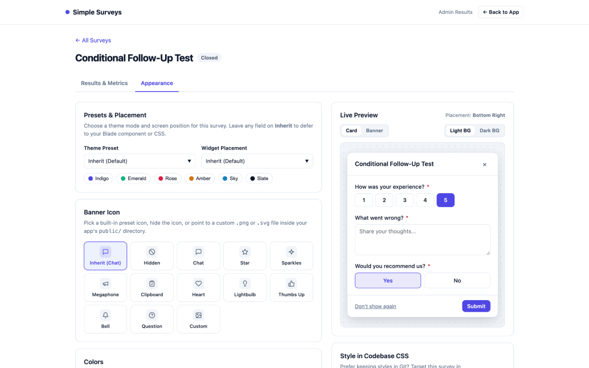
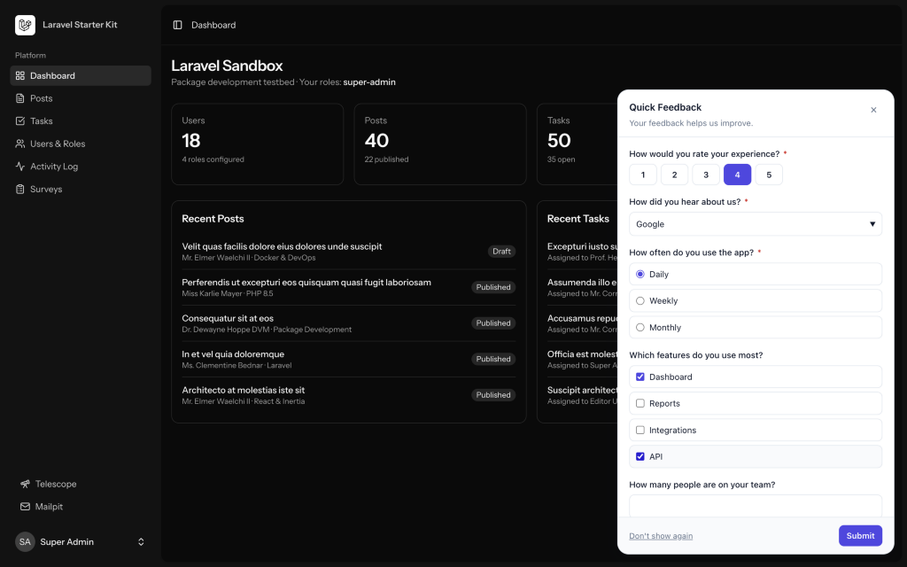
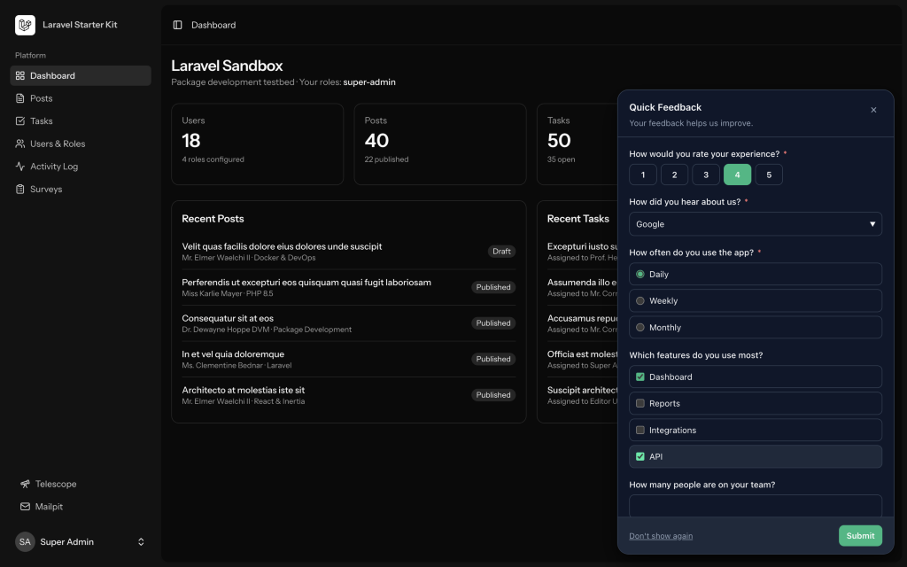
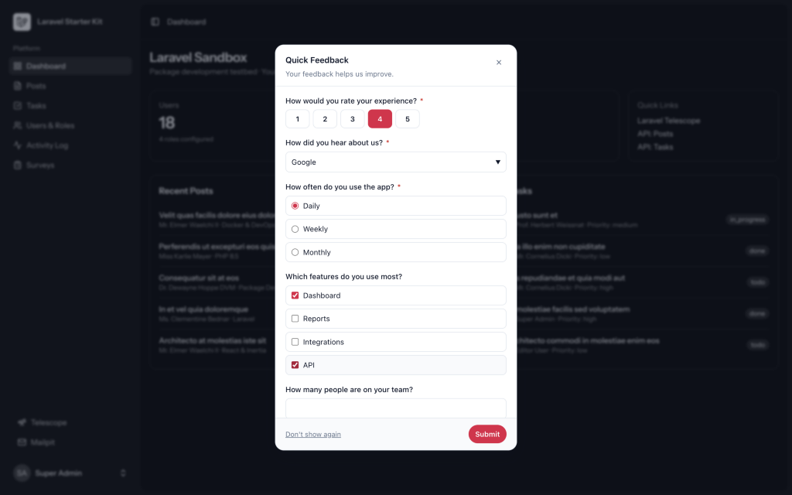
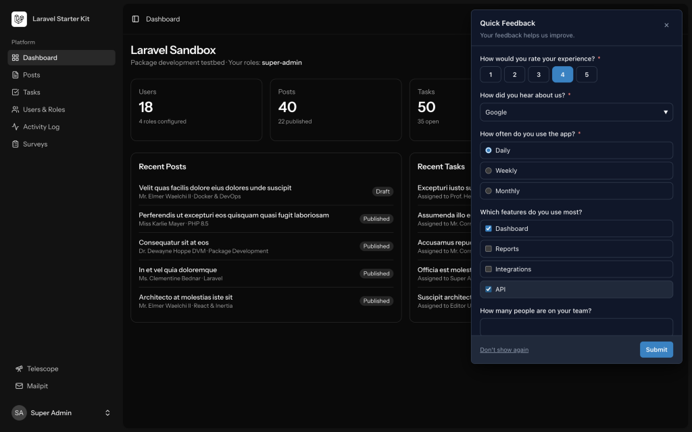

[← Back to README](../README.md)

# Appearance & Styling

Simple Surveys is designed so you can match your brand either **in Git-tracked CSS** or **visually per survey in the Admin Dashboard**—with zero `!important` hacks.



---

## Widget Preset Gallery

Mix and match `light` / `dark` / `auto` themes, 5 screen placements, accent palettes, and border radii either via CSS variables or the Admin **Appearance** tab:

| Light · Indigo (Default, `bottom-right`) | Dark · Emerald (`bottom-right`) |
| :---: | :---: |
|  |  |
| **Centered Modal · Rose (`center`, pill buttons)** | **Dark · Sky (`top-right`, sharp radii)** |
|  |  |

---

## Style Precedence

Every built-in widget selector is wrapped in zero-specificity `:where(...)` and reads public `--lss-*` custom properties. Host styles always win cleanly:

1. **Built-in defaults** (`light` / `dark` / `auto` preset) *(lowest)*
2. **Global CSS overrides** in your app stylesheet (`.lss-root` or `:root`)
3. **Per-survey CSS overrides** in your app stylesheet (`[data-lss-survey="your-survey-key"]`)
4. **Admin Dashboard Appearance overrides** saved per survey *(highest)*

---

## 1. Styling in Your Codebase (CSS)

Publish the documented starter override stylesheet to `resources/css/simple-surveys.css`:

```bash
php artisan vendor:publish --tag="simple-surveys-styles"
```

Import it in your main stylesheet (for example `resources/css/app.css`):

```css
@import './simple-surveys.css';
```

### Global & Per-Survey Overrides

```css
/* Global overrides (every survey widget) */
.lss-root {
    --lss-accent: #10b981;
    --lss-accent-hover: #059669;
    --lss-radius: 14px;
    --lss-card-width: 420px;
}

/* Tailwind class-based dark mode (.dark) */
.dark .lss-root {
    --lss-bg: #0f172a;
    --lss-surface: #1e293b;
    --lss-border: #334155;
    --lss-text: #f8fafc;
    --lss-muted: #94a3b8;
}

/* Target a single survey by its registered key */
[data-lss-survey="onboarding-feedback"] {
    --lss-accent: #0284c7;
    --lss-card-width: 460px;
}

[data-lss-survey="onboarding-feedback"] .lss-btn-primary {
    border-radius: 9999px;
}
```

### Public CSS Custom Properties Reference

| Token | Default (Light) | Purpose |
| :--- | :--- | :--- |
| `--lss-accent` | `#4f46e5` | Primary button, active rating/choice highlight |
| `--lss-accent-hover` | `#4338ca` | Primary button hover color |
| `--lss-accent-soft` | `rgba(79, 70, 229, 0.12)` | Soft accent tint (icon badge, selected choice fill) |
| `--lss-accent-ring` | `rgba(79, 70, 229, 0.18)` | Input focus ring color |
| `--lss-btn-text` | `#ffffff` | Primary button text color |
| `--lss-bg` | `#ffffff` | Card and banner background |
| `--lss-surface` | `#f8fafc` | Footer / subtle surface background |
| `--lss-border` | `#e2e8f0` | Card, input, and divider borders |
| `--lss-text` | `#0f172a` | Primary heading and label text |
| `--lss-muted` | `#64748b` | Description, help text, and secondary controls |
| `--lss-danger` / `--lss-danger-soft` / `--lss-danger-border` | `#dc2626` / `#fef2f2` / `#fecaca` | Validation error states |
| `--lss-success` / `--lss-success-soft` | `#16a34a` / `#dcfce7` | Thank-you confirmation icon & badge |
| `--lss-card-width` | `390px` | Expanded survey card width |
| `--lss-card-max-height` | `82vh` | Maximum expanded card height before scrolling |
| `--lss-banner-max-width` | `380px` | Collapsed banner max width |
| `--lss-offset` | `20px` | Distance from viewport edge |
| `--lss-z-index` | `9999` | Stacking context `z-index` |
| `--lss-radius` | `12px` | Card and banner border radius |
| `--lss-btn-radius` | `8px` | Button border radius |
| `--lss-input-radius` | `8px` | Input/select/textarea border radius |
| `--lss-shadow` | Layered drop shadow | Card and banner elevation |
| `--lss-backdrop` | `rgba(15, 23, 42, 0.48)` | Modal backdrop color (`position="center"`) |
| `--lss-font-family` | System sans stack | Widget font stack |
| `--lss-font-size` | `14px` | Base font size |

### Stable Class & Attribute Hooks

- Root & containers: `.lss-root`, `[data-lss-survey="<key>"]`, `[data-lss-theme="light|dark|auto"]`, `[data-lss-position="..."]`, `.lss-backdrop`
- Banner: `.lss-banner`, `.lss-banner-icon`, `.lss-banner-icon-img`, `.lss-banner-text`, `.lss-banner-actions`
- Card: `.lss-card`, `.lss-card-header`, `.lss-card-title`, `.lss-card-desc`, `.lss-card-body`, `.lss-card-footer`
- Fields & controls: `.lss-field`, `.lss-label`, `.lss-help`, `.lss-input`, `.lss-textarea`, `.lss-select`, `.lss-options`, `.lss-option-item`, `.lss-rating-group`, `.lss-rating-item`, `.lss-boolean-group`, `.lss-boolean-item`
- Buttons & states: `.lss-btn-primary`, `.lss-btn-icon`, `.lss-btn-link`, `.lss-error`, `.lss-general-error`, `.lss-thanks`, `.lss-thanks-icon`, `.lss-thanks-msg`

---

## 2. Visual Editor in the Admin Dashboard

Open any registered survey at `/simple-surveys/admin/{surveyKey}` and switch to the **Appearance** tab to customize a survey visually with a **live interactive preview** (toggleable between **Card** / **Banner** and **Light BG** / **Dark BG**):

- **Presets & Placement:** Theme (`light`, `dark`, `auto`), placement (`bottom-right`, `bottom-left`, `top-right`, `top-left`, `center`), and one-click accent palettes (`Indigo`, `Emerald`, `Rose`, `Amber`, `Sky`, `Slate`).
- **Banner Icon:** 10 built-in SVG presets, hidden (`none`), or a custom `.png`/`.svg` path inside `public/`.
- **Colors:** Accent, hover, button text, background, surface, border, primary text, and muted text.
- **Dimensions & Shape:** Card width, card max height, banner max width, and card/button/input border radii.
- **Typography:** Base font size and font family.

Any field left blank inherits from your codebase CSS. Click **Reset to Defaults** to clear all Dashboard overrides for that survey.

### Enforcing CSS-Only Styling

To disable the Dashboard Appearance editor across your team, set `admin.appearance_editor` to `false` in `config/simple-surveys.php`:

```php
'admin' => [
    'appearance_editor' => false,
],
```

---

← Previous: [Customer Widget & SPA Mode](widget.md) | Next: [Headless / API-Only Setup →](headless-api.md)
