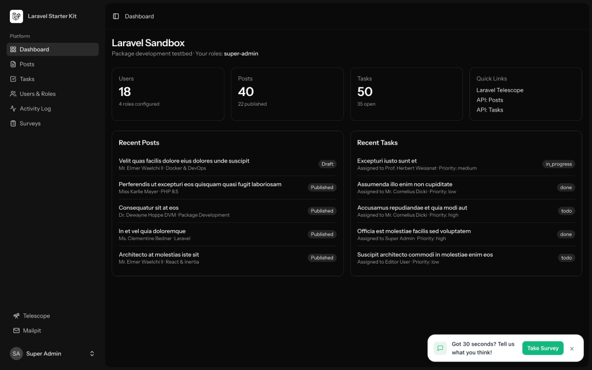
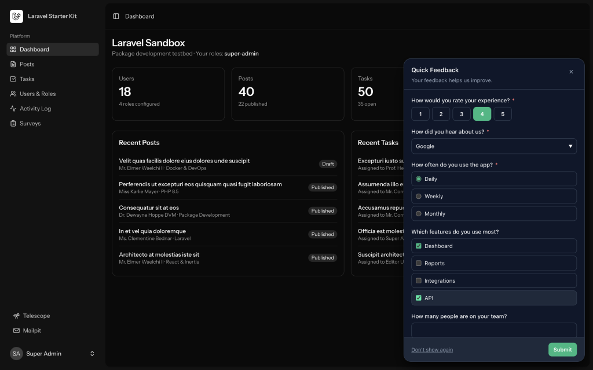
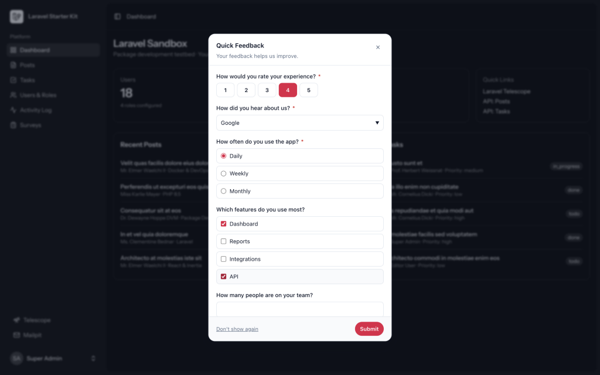

[← Back to README](../README.md)

# Customer Widget & SPA Mode

Drop a single Blade component into your layout to render the customer-facing banner and expandable survey card—with zero JavaScript build steps, zero CSS leaks, and 0 DB queries for unauthenticated guests.



---

## Basic Usage

Add `<x-simple-surveys::widget />` to your base layout right before `</body>`:

```blade
<x-simple-surveys::widget />
```

When the authenticated user has an eligible survey, the widget renders a compact floating banner. Clicking **Take Survey** expands the survey card, records an open event (`POST /{prefix}/{key}/open`), and handles inline validation, conditional questions, dismissal, and thank-you confirmation automatically.

If the user is a guest or has no eligible surveys, the component renders nothing.

---

## Component Attributes

```blade
{{-- Target a specific survey key in the bottom-left with dark theme --}}
<x-simple-surveys::widget
    survey="onboarding-feedback"
    position="bottom-left"
    theme="dark"
/>

{{-- Centered modal placement with automatic light/dark detection --}}
<x-simple-surveys::widget position="center" theme="auto" />

{{-- Custom banner icon (preset, public/ asset, or hidden) --}}
<x-simple-surveys::widget icon="sparkles" />
<x-simple-surveys::widget icon="images/survey-icon.svg" />
<x-simple-surveys::widget icon="none" />

{{-- Enable Dynamic SPA mode for Inertia.js / Livewire wire:navigate --}}
<x-simple-surveys::widget dynamic />
```

| Attribute | Default | Accepted Values |
| :--- | :--- | :--- |
| `survey` | `null` | Specific registered survey key. When omitted, displays the highest-priority eligible survey for the user. |
| `position` | `'bottom-right'` | `'bottom-right'`, `'bottom-left'`, `'top-right'`, `'top-left'`, `'center'` (bottom-center banner that opens a centered modal with backdrop). |
| `theme` | `'light'` | `'light'`, `'dark'`, `'auto'` (follows `prefers-color-scheme: dark`). |
| `icon` | `config('simple-surveys.widget.icon')` (`'chat'`) | Built-in preset (`chat`, `star`, `sparkles`, `megaphone`, `clipboard`, `heart`, `lightbulb`, `thumbs-up`, `bell`, `help`), `'none'`, or a relative path under `public/` ending in `.png` or `.svg` (resolved via `asset()`). |
| `dynamic` | `false` | Boolean flag enabling Dynamic SPA refresh mode. |
| `nonce` | `null` | Explicit Content-Security-Policy (CSP) nonce applied to inline `<style>` and `<script>` tags, overriding automatic resolution. |

### Themes & Placements Preview

| Dark Theme (`theme="dark" position="bottom-right"`) | Centered Modal (`position="center"`) |
| :---: | :---: |
|  |  |

> See [Appearance & Styling](styling.md#widget-preset-gallery) for more preset combinations, accent palettes, and CSS token overrides.

### Icon Resolution Precedence

1. Admin Dashboard **Appearance** override (highest)
2. Per-survey PHP definition (`Survey::make(...)->icon(...)` / `->withoutIcon()`)
3. Blade component `icon="..."` attribute
4. Global `config('simple-surveys.widget.icon')` (default `'chat'`)

---

## Dynamic SPA Mode (`dynamic`)

In **Inertia.js**, **Livewire** (`wire:navigate` / `@persist`), or other SPAs where your root Blade layout stays mounted across page transitions, pass the `dynamic` attribute:

```blade
<x-simple-surveys::widget dynamic />
```

What `dynamic` does:

1. Keeps a lightweight mount container (`[data-lss-dynamic-mount]`) in the DOM even when no survey is eligible on the initial page.
2. Automatically fetches `GET /{prefix}/widget?url=<current-pathname>` (preserving your `survey`, `position`, `theme`, and `icon` attributes) whenever:
   - Inertia finishes a visit (`inertia:navigate`)
   - Livewire finishes a navigation (`livewire:navigated`)
   - Your application manually triggers a refresh:

```js
window.dispatchEvent(new CustomEvent('simple-surveys:refresh'));
```

This lets route/path-targeted surveys (`->onPaths('/billing/*')`) and newly eligible surveys (e.g. right after a user completes an onboarding step) appear seamlessly without a full page reload.

> **Using Livewire `wire:navigate`?** Wrap the component in `@persist('simple-surveys') ... @endpersist` if you want an open survey card to survive client-side navigations.

> **Building a fully custom React/Vue/Svelte widget?** Use the JSON endpoints documented in [Headless / API-Only Setup](headless-api.md).

---

## Content Security Policy (CSP) Nonce

All inline `<style>` and `<script>` tags rendered by the widget, dynamic SPA wrapper, and Admin Results Dashboard automatically emit a `nonce="..."` attribute whenever a CSP nonce is active (and omit it otherwise).

Resolution precedence:

1. Explicit Blade component attribute (`<x-simple-surveys::widget nonce="..." />`)
2. Custom callback registered via `SimpleSurveys::resolveCspNonce(...)` (e.g. for `spatie/laravel-csp` or request attributes)
3. Laravel's built-in `Vite::cspNonce()` (automatic when `Vite::useCspNonce()` is active)

```php
// AppServiceProvider::boot() — e.g. integration with spatie/laravel-csp
use DanielCristea\SimpleSurveys\Facades\SimpleSurveys;

SimpleSurveys::resolveCspNonce(fn (): ?string => app('csp-nonce'));
```

In `dynamic` SPA mode, the mount container stores `data-lss-nonce` so fetched widget `<style>` and `<script>` elements preserve the active page nonce on client-side navigations.

---

## Publishing Blade Views

For full HTML markup control, publish the package's Blade views into `resources/views/vendor/simple-surveys/`:

```bash
php artisan vendor:publish --tag="simple-surveys-views"
```

If you only need visual changes (colors, borders, sizing, typography, or per-survey themes), see [Appearance & Styling](styling.md)—you rarely need to fork the Blade templates.

---

← Previous: [Audience Targeting & Scheduling](targeting.md) | Next: [Appearance & Styling →](styling.md)
